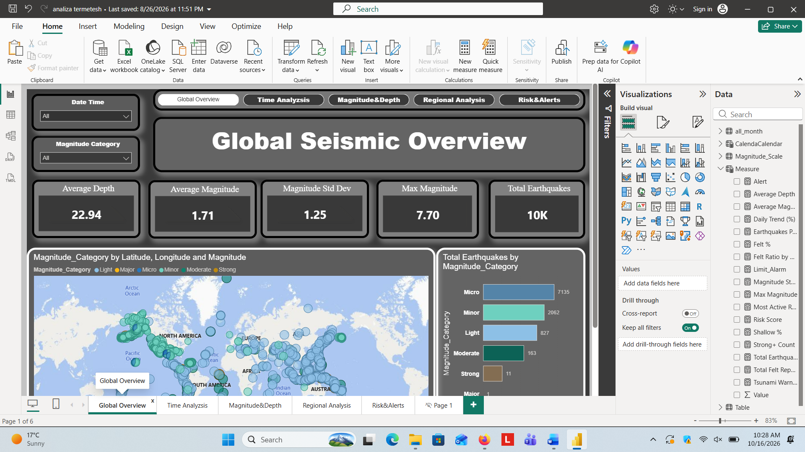
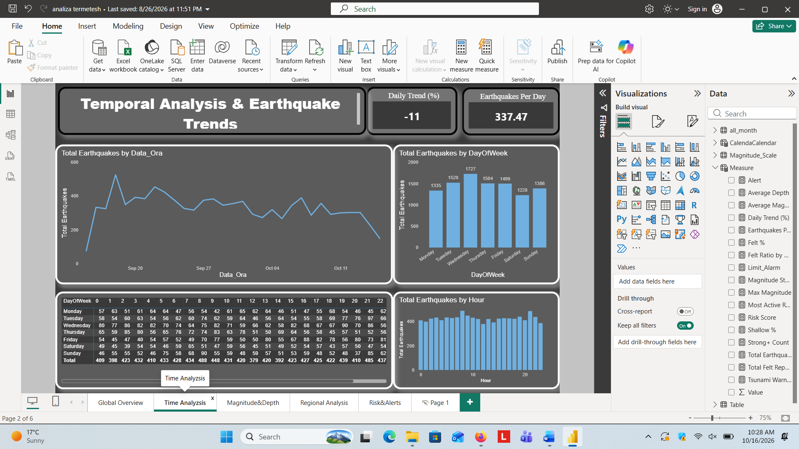
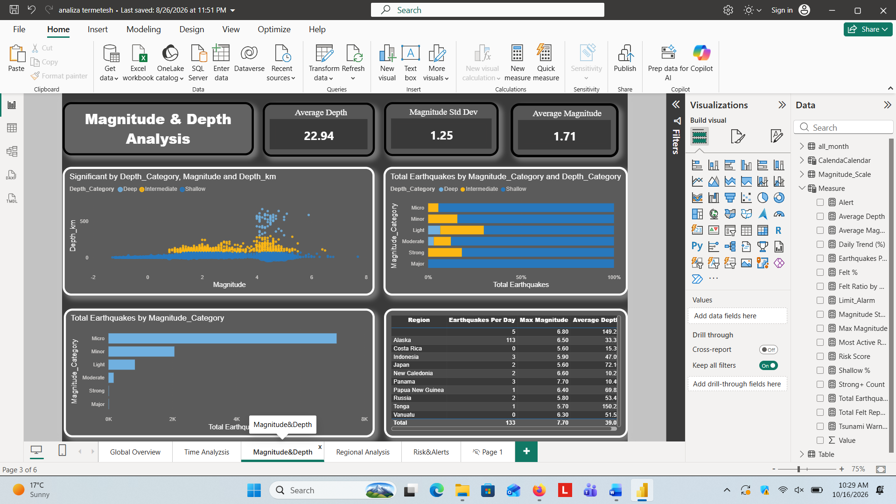
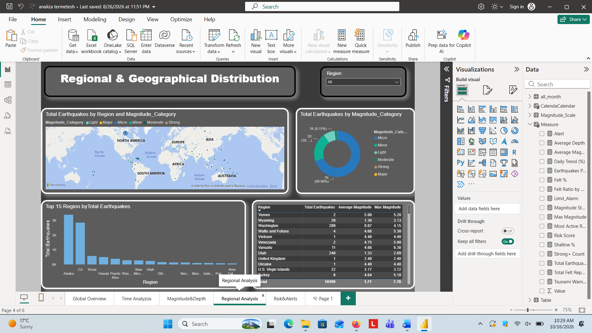
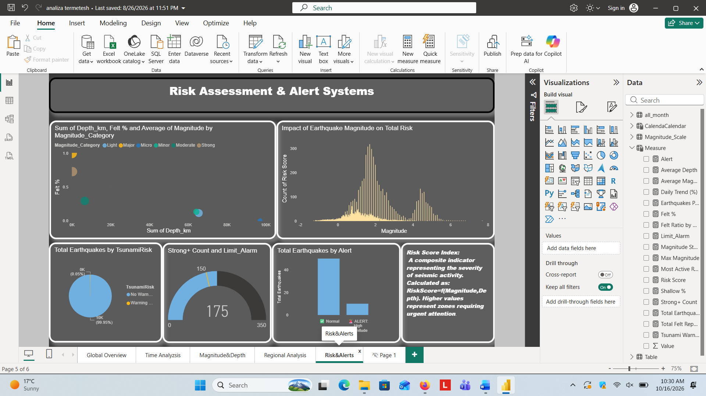

# 🌍 Global Earthquake Risk & Seismic Analytics Dashboard

An end-to-end Interactive **Power BI Dashboard** for global seismic activity analysis, magnitude trends, depth distribution, and automated risk scoring based on USGS earthquake data.

---

## 📌 Executive Summary

This project provides a comprehensive analysis of global earthquake patterns, seismic risks, and temporal trends. Designed with dark-mode aesthetic principles and optimized UX/UI, the dashboard helps synthesize complex geographic and temporal data into actionable insights through custom metrics and interactive drill-downs.

---

## 📸 Dashboard Preview

### 1. Global Overview


### 2. Temporal & Trend Analysis


### 3. Magnitude & Depth Analysis


### 4. Regional Analysis


### 5. Risk Assessment & Alerts


---

## 🛠️ Data Architecture & Tech Stack

* **Business Intelligence Tool:** Microsoft Power BI Desktop
* **Data Transformation:** Power Query (GeoJSON/CSV parsing, data cleaning, and conditional column creation)
* **Data Modeling:** Star Schema design with dedicated `Calendar` and `Measure` tables.
* **DAX Formulas:** Custom measures for dynamic time intelligence, standard deviation calculations, and conditional risk alerts.

---

## 🚀 How to View the Project

1. Clone or download this repository:
   ```bash
   git clone [https://github.com/Ralfi2208/global-earthquake-risk-analytics.git](https://github.com/Ralfi2208/global-earthquake-risk-analytics.git)
